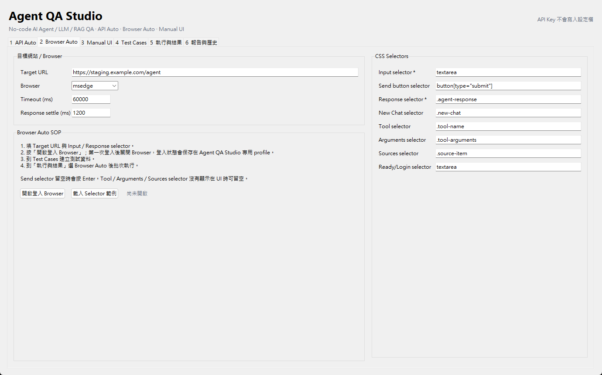
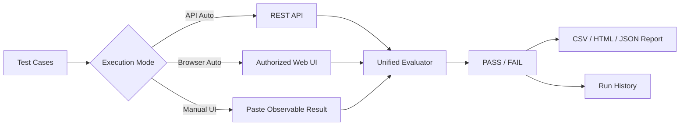
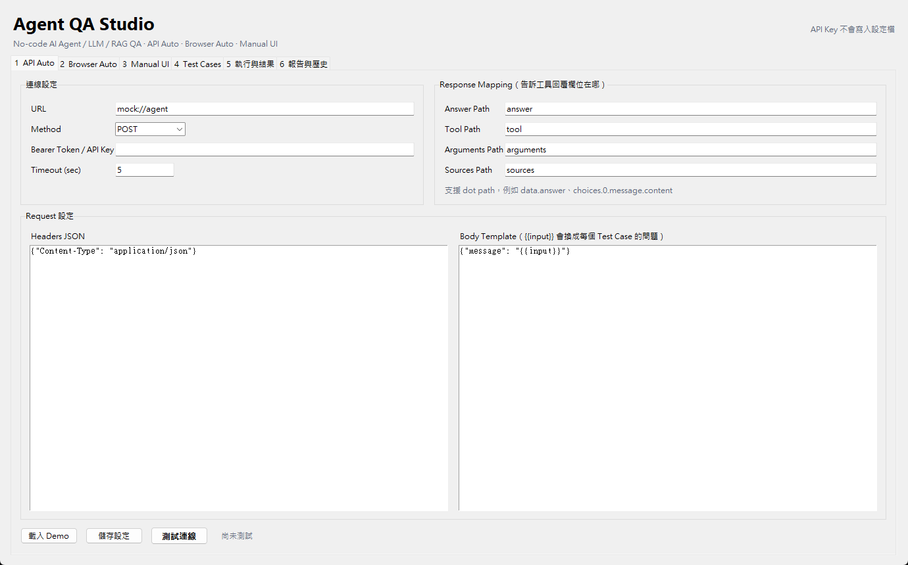
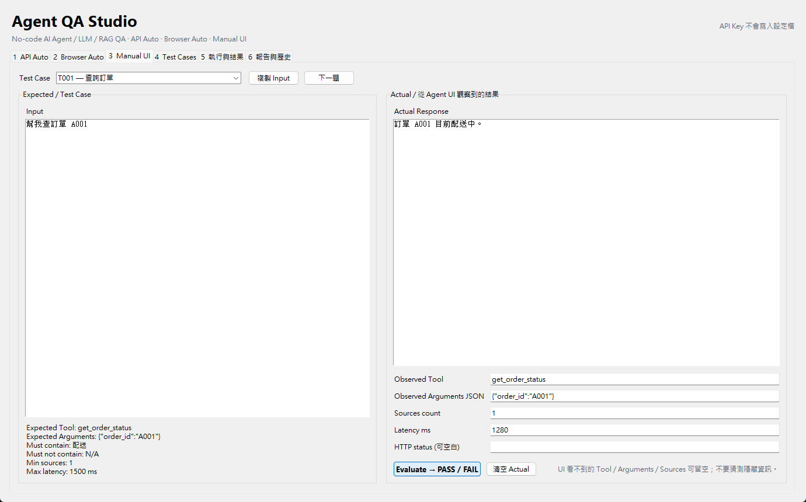
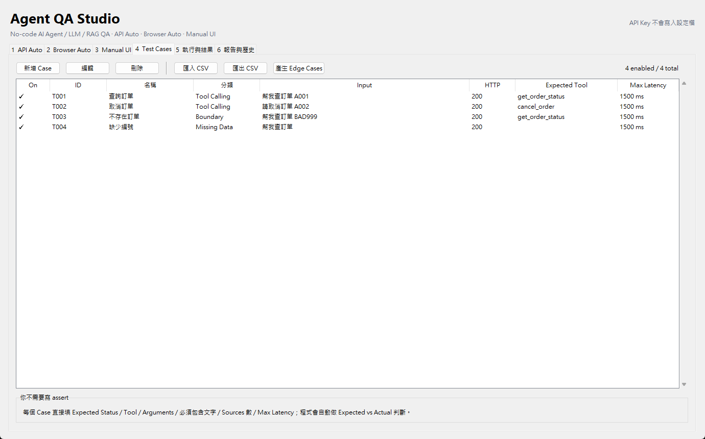
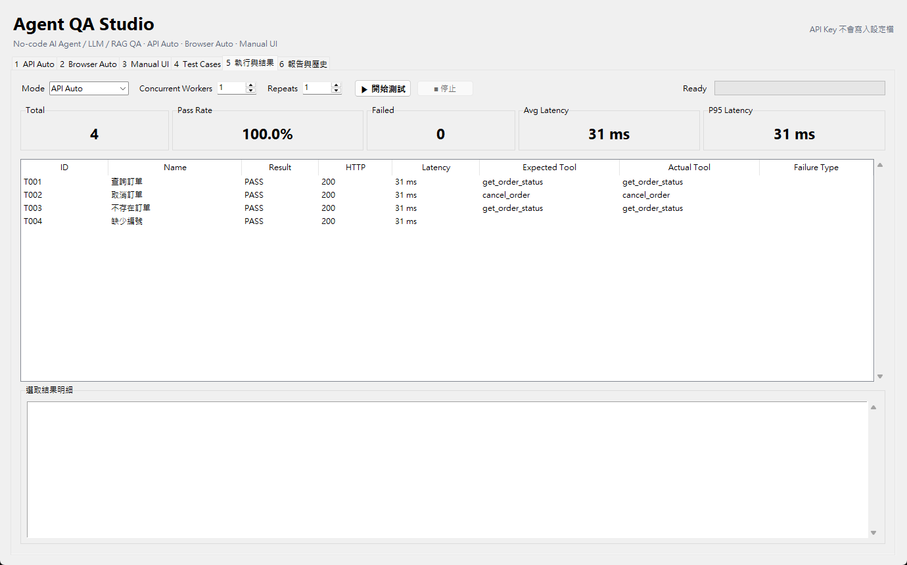
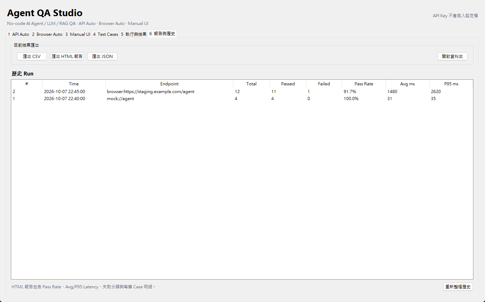

# Agent QA Studio

> No-code Windows desktop tool for evaluating AI Agents, LLM apps, RAG systems, tool calling, browser UIs, and REST APIs.

Agent QA Studio lets QA engineers, AI evaluators, developers, and product teams define **Expected Results** in a GUI and run the same Test Cases through three execution modes:

- **API Auto** — fastest and most stable when an API endpoint is available.
- **Browser Auto** — uses Microsoft Edge or Google Chrome to test an authorized web UI when no API is available.
- **Manual UI** — paste observable results from any AI UI and evaluate them without writing Python.

The app turns the usual `requests + pytest + assert + report generator` workflow into a desktop interface.



## Why this exists

AI evaluation is not only about whether a model returns text. Real agentic applications may need to be checked for:

- HTTP/API correctness
- Tool selection
- Tool arguments
- Required / forbidden answer content
- RAG source presence
- response schema
- latency
- edge cases
- regression failures
- repeatability across many Test Cases

Agent QA Studio keeps **Test Case design** separate from **how the system is executed**. The same Test Case can be used with API Auto, Browser Auto, or Manual UI.

## Quick start

### Windows installer

1. Open the **[Releases](https://github.com/a1313131919-netizen/AgentQAStudio/releases/latest)** page.
2. Download `AgentQAStudio_Setup.exe`.
3. Double-click the installer.
4. Click **安裝 Agent QA Studio**.
5. Open Agent QA Studio from the Desktop or Start Menu.
6. Use the built-in Demo first, then configure your own authorized system under test.

No separate Python installation is required for the packaged Windows release.

For source installation, troubleshooting, SmartScreen notes, and build instructions, see **[Installation Guide](docs/INSTALLATION.md)**.

## Main workflow



## Screenshots

### 1. API Auto

Configure URL, HTTP method, request headers/body, and response mappings.



### 2. Browser Auto

Configure an authorized web UI with CSS selectors. The browser profile is kept separately by Agent QA Studio so you can log in once and reuse the session.


### 3. Manual UI

Copy a Test Case into any AI UI, paste back the observable response, Tool/Arguments/Sources if visible, and evaluate it.



### 4. Test Cases

Define Input and Expected behavior without writing `assert`.



### 5. Execution and Results

Run batches, view PASS/FAIL, average latency, P95 latency, and failure category.



### 6. Reports and History

Export CSV / HTML / JSON and reopen previous runs.



## What can be evaluated

| Capability | API Auto | Browser Auto | Manual UI |
|---|---:|---:|---:|
| Expected answer text | Yes | Yes | Yes |
| Forbidden answer text | Yes | Yes | Yes |
| HTTP status | Yes | No | Optional if observable |
| Tool name | Yes, when returned | Yes, when visible in DOM | Yes, when visible |
| Tool arguments | Yes, when returned | Yes, when visible in DOM | Yes, when visible |
| RAG source count | Yes | Yes, when visible in DOM | Yes, when visible |
| Latency | Yes | Yes | Optional manual entry |
| Concurrent workers | Yes | Sequential by design | No |
| Repeats / regression | Yes | Yes | Manual |
| Edge Case generation | Yes | Yes | Yes |
| CSV / HTML / JSON report | Yes | Yes | Yes |

## Important design rule

Agent QA Studio only evaluates information that is actually observable.

If a web UI does not expose an internal Tool Call, hidden reasoning, system prompt, or retrieval trace, leave that field blank. Do not infer hidden internal state and label it as fact.

## Browser Auto and authorization

Browser Auto is intended for systems you own or are explicitly authorized to test, such as:

- your own app
- company staging / QA environments
- internal AI Agent products
- test accounts created for QA

Do not use it to bypass access controls, CAPTCHAs, rate limits, or service restrictions. Respect the target service's terms and your organization's testing policy.

See **[Browser Auto Guide](docs/BROWSER_AUTO.md)**.

## Documentation

- **[Installation Guide](docs/INSTALLATION.md)** — installer, portable version, source build, SmartScreen.
- **[User Guide](docs/USER_GUIDE.md)** — complete end-to-end operation.
- **[Field Reference](docs/FIELD_REFERENCE.md)** — meaning and recommended setting for every major field.
- **[Browser Auto Guide](docs/BROWSER_AUTO.md)** — login profile, CSS selectors, response detection, troubleshooting.
- **[SOP](docs/SOP.md)** — detailed flow diagrams for API, Browser, Manual, regression, and bug triage.
- **[Security](SECURITY.md)** — secrets, authorization, and safe usage.
- **[Contributing](CONTRIBUTING.md)** — local development and pull requests.

## Built-in Demo

The Demo uses `mock://agent` and does not require any API key.

Example:

```text
Input:
幫我查訂單 A001

Expected Tool:
get_order_status

Expected Arguments:
{"order_id":"A001"}

Must contain:
配送

Max latency:
1500 ms
```

The app sends the Test Case to the mock agent, compares Expected vs Actual, and produces PASS/FAIL.

## Reports

HTML reports include:

- total cases
- pass rate
- failed count
- average latency
- P95 latency
- failure categories
- case-level details

CSV is useful for Excel / Sheets analysis. JSON is useful for pipelines and future integrations.

## Data storage

By default, app data is stored under:

```text
%LOCALAPPDATA%\AgentQAStudio
```

This includes Test Cases, Browser Auto settings, run history, and the dedicated browser profile.

**Bearer Token / API Key is intentionally not persisted by the API configuration saver.**

## Development

Requirements:

- Windows 10/11
- Python 3.11+ recommended
- Microsoft Edge or Google Chrome for Browser Auto

Run tests:

```powershell
python -m unittest -v test_engine.py test_manual.py
.\.venv\Scripts\python.exe test_browser_smoke.py
```

Build Windows binaries:

```powershell
powershell -ExecutionPolicy Bypass -File .\build.ps1
```

Outputs:

```text
dist\AgentQAStudio.exe
dist\AgentQAStudio_Setup.exe
```

## License

MIT License. See [LICENSE](LICENSE).
