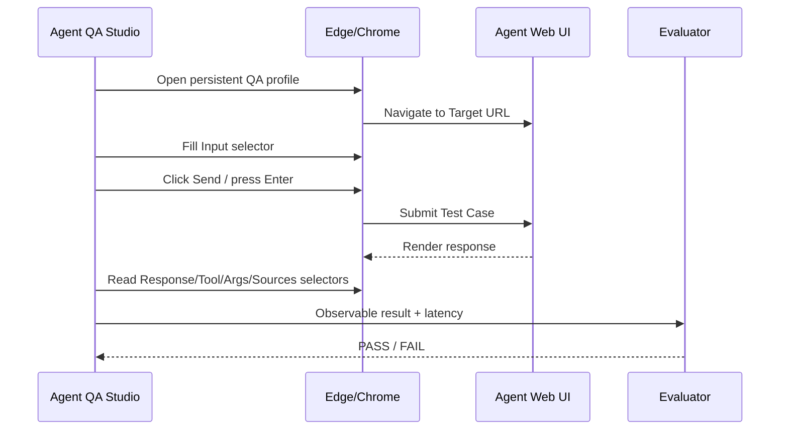

# Browser Auto Guide

Browser Auto lets Agent QA Studio test an authorized AI web interface even when you do not have an API endpoint.

## Architecture

## Login profile

Agent QA Studio uses a dedicated browser profile under its local app-data directory.

This is deliberate:

- it does not need your normal browser profile,
- login state can persist between QA runs,
- QA cookies/session data stay separated from daily browsing.

### First login

1. Configure Target URL and required selectors.
2. Click **開啟登入 Browser**.
3. Log in manually.
4. Confirm the app page is usable.
5. Close the browser window.
6. The dedicated profile remains for subsequent Browser Auto runs.

Do not put passwords into Test Cases.

## Finding selectors

Use browser Developer Tools only when you are authorized to inspect the target application.

Typical method:

1. Open the QA site.
2. Press F12.
3. Use the element picker.
4. Click the prompt input.
5. Prefer stable attributes such as:
   - id
   - `data-testid`
   - stable semantic classes
6. Repeat for response and Send button.

Avoid selectors based on deeply nested `:nth-child(...)` structures when a stable attribute exists.

## Response selector

The Response selector should match assistant/agent response elements.

Agent QA Studio records the number and latest text before sending the prompt, then waits until:

1. a new response appears or the latest response changes,
2. the response becomes non-empty,
3. the text stops changing for **Response settle (ms)**.

This helps with streaming responses.

## New Chat selector

Set this if each Test Case must be isolated.

If it is blank, cases run in the same conversation, which can be useful for multi-turn tests but can also create cross-case contamination.

## Tool / Arguments / Sources selectors

These are optional.

Only configure them if the UI visibly exposes those values.

If the product keeps internal traces hidden, leave these selectors blank and do not define Expected Tool/Arguments as a Browser UI release gate unless another observable trace is available.

## Troubleshooting

### Browser opens but test cannot type

Check **Input selector**.

### Prompt is filled but not submitted

- configure Send selector, or
- leave Send selector blank if Enter submits.

### Response timeout

Check:

- Response selector
- login state
- model actually finished
- Timeout
- whether the response is inside an iframe/shadow DOM not addressed by the simple selector

### Wrong response captured

Make Response selector more specific so it matches only agent responses.

### UI changed after a deployment

Browser UI automation is inherently more fragile than API testing. Update selectors and rerun smoke tests.

## Service rules

Use Browser Auto only where automated UI testing is authorized. Do not use it to bypass access controls, CAPTCHAs, rate limits, or restrictions.
