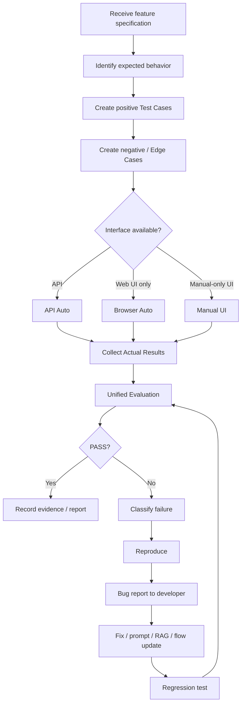
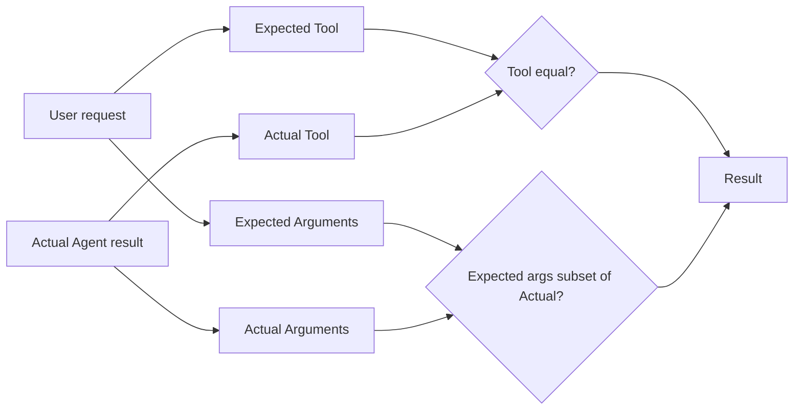
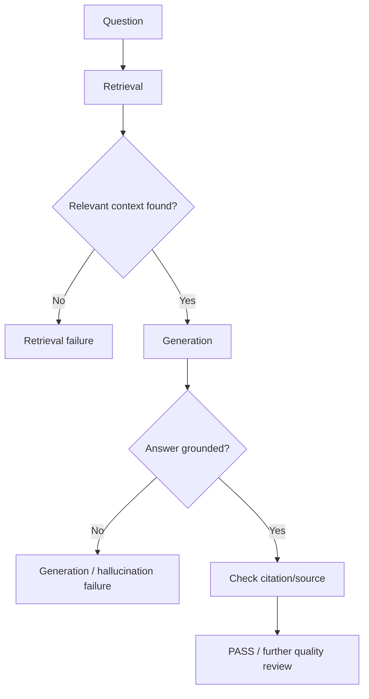
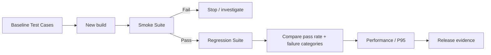
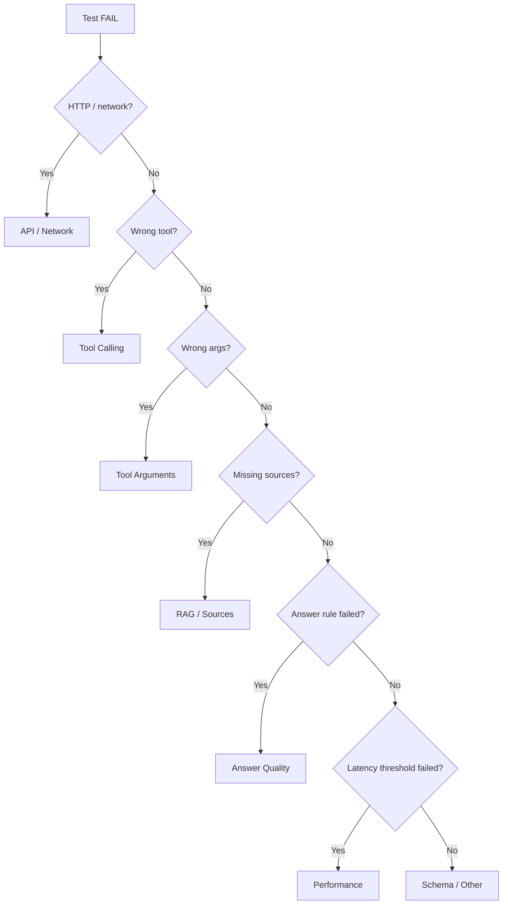

# QA SOP

## SOP 1 — New Agent feature acceptance



## SOP 2 — Tool Calling evaluation



Checklist:

1. Is the tool selected for the correct intent?
2. Are required arguments present?
3. Are identifiers copied correctly?
4. Does missing input trigger clarification instead of hallucination?
5. Does tool failure produce a safe response?
6. Is the agent prevented from silently pretending the tool succeeded?

## SOP 3 — RAG evaluation



When the answer is wrong, separate:

- Retrieval problem
- Generation problem
- source/knowledge problem
- prompt/instruction problem
- tool-routing problem

## SOP 4 — Regression suite



Recommended layers:

- Smoke: critical happy paths
- Functional regression
- Edge/corner cases
- RAG/tool-calling cases
- performance/latency cases

## SOP 5 — Failure triage



## Bug report template

```text
Title:
[Agent][Tool Calling] Wrong tool selected for order cancellation

Environment:
Staging / build version

Case ID:
T042

Input:
取消訂單 A002

Expected:
Tool = cancel_order
Arguments = {"order_id":"A002"}

Actual:
Tool = get_order_status

Result:
FAIL

Reproduction:
1. Start new chat.
2. Submit the input.
3. Observe tool trace.

Evidence:
Agent QA Studio HTML/JSON report

Notes:
Reproducible 5/5 times.
```
